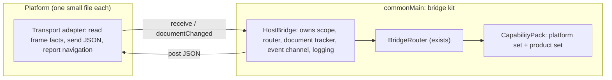

# Bridge kit: make the host bridge reusable before mobile

**Status:** Approved by Tim on 2026-10-14 (product set chosen for G5).
**Date:** 2026-10-14
**Feature slug:** `bridge-kit`
**Builds on:** [host-bridge design](2026-10-14-host-bridge-design.md), ADR-001
**ADR:** [ADR-002](../adrs/002-bridge-kit.md)

## Summary

The shared router works. Its 11 tests pass on JVM, Android and iOS. But the
parts around the router are not reusable yet. The desktop transport holds
duties that each new platform must copy. The tests check the router, but not
that each platform behaves the same way. This plan moves those duties into
`commonMain`. It adds one test kit that every transport must pass. Then it
builds the Android and iOS transports on that kit.

## What I checked (2026-10-14, Tim's Mac)

| Check | Result |
|---|---|
| `:composeApp:jvmTest` | 84 tests, 0 failures. A snapshot: later review fixes add tests, so the base now has more. |
| `:composeApp:testDebugUnitTest` (Android) | 16 tests, 0 failures. `BridgeRouterTest`: 11 |
| `:composeApp:iosSimulatorArm64Test` | 20 tests, 0 failures. `BridgeRouterTest`: 11 |
| Compile iOS simulator and Android debug | Pass |

These facts limit the claim:

- The mobile targets build only with `-Pgamero.mobileTargets=true`.
- Android needs `ANDROID_HOME`. The shell does not set it.
- iOS needs `DEVELOPER_DIR=/Applications/Xcode.app/Contents/Developer`, because
  `xcode-select` points to the Command Line Tools.
- The repository has no CI. Nothing runs the mobile tests on its own.

## Gaps against the goals

Tim's goals are: reusable, extensible, consistent, and safe by default.

| # | Gap | Goal it hurts | Evidence |
|---|---|---|---|
| G1 | The transport duties are prose, not code. The JCEF transport makes its own scope, router, event channel, document id and failure log. Android and iOS would copy all of this. | Reusable, consistent | `NativeBridge.kt` lines 62–75 (scope, router, failure log); `companion/JcefV2Queries.kt` lines 23–30 (watch and `events()`) and line 40 (`documentId = frameId`) |
| G2 | No shared transport test runs on every platform. The router tests do not prove that each platform reports frame facts, ends a context on navigation, or delivers events the same way. | Consistent | QA plan item 4 says "one test per transport". Only JCEF has transport tests: `JcefV2QueriesTest` (6 tests) covers untrusted frames, the watch and its events, and cancelling the watch. Android and iOS would each have to write their own. |
| G3 | A capability lists its methods two times. The binder matches handlers to methods by list position and checks this at run time. | Reusable | `Haptics.kt`: `listOf(PLAY)` and `listOf(PLAY.handle {...})` |
| G4 | Methods have types, events do not. An event is a string name and a `JsonElement`. | Consistent, extensible | `Lifecycle.kt`, `BridgeRouter.emit` |
| G5 | A product capability sits in the shared core. `companion` is Hovel on desktop only, but each platform factory must name it. Each new product adds a parameter that every platform must name. | Extensible | `HostCapabilities.kt` |
| G6 | A call has no time limit. A capability that hangs keeps its call open until the page navigates. | Consistent | `BridgeRouter.run` |
| G7 | Two haptics paths exist. The legacy `HapticManager` (it does not run) and the new `Haptics` capability. About 55 legacy `expect fun` functions stay as dead code. | Maintainable | `managers/*Platform.*.kt` |
| G8 | The parity test is the last task (C5), but the consistency claim depends on it. | Consistent | EM plan, phase C |

## Approaches

1. **Extract the kit with the second transport (recommended).** Do the small
   core fixes first. Then build the Android transport and extract the shared
   transport parts at the same time. Android is the second real user, so it
   proves the abstraction. iOS is the third user. If iOS needs no change to
   the kit, the kit is reusable.
2. **Kit first, then mobile.** Extract all transport parts from JCEF before
   Android starts. This is faster to start, but it designs from one example
   only. We will change the kit again when Android shows a difference.
3. **Build mobile now, extract later.** Copy the JCEF pattern into Android and
   iOS, then remove the copies. This gives three versions to align, and the
   consistency problems show up late.

I recommend approach 1. It follows the rule "hold an abstraction until a second
real use confirms it", and it does not let three copies grow.

## Design

### K-layer: what moves into `commonMain`

The platform file only talks to its WebView. Everything with a rule moves into
the kit.

1. **`HostBridge` (G1).** A class in `commonMain` that owns the scope, the
   router, the document id and the failure log. A transport adapter gives it
   three things:
   1. `receive(raw, frame, reply)` for each message.
   2. `post(json)` for events.
   3. A document signal. Android and iOS call `documentChanged()` when the
      main frame gets a new document. JCEF has no navigation signal of its
      own: it calls `endContext(contextId)` when a watch query ends, so the
      end closes only that watch's context and never a newer one.

   The document id becomes a counter inside `HostBridge`. A platform does not
   make its own id. JCEF, Android and iOS then end contexts by the same rule.
2. **Typed handlers (G3).** A method binds with the capability as a parameter:
   `PLAY.handle { haptics: Haptics, args -> haptics.play(args.effect) }`. The
   binder gets its method list from the handlers. The compiler checks the
   match, and the run-time list check goes away.
3. **Typed events (G4).** Add `BridgeEvent<D>(name, serializer)`, the same shape
   as `BridgeMethod`. `emit` takes a typed event and a typed value. The
   contract in event-contracts gets a zod schema for each event payload.
4. **Platform set and product set (G5).** `HostCapabilities` keeps only the
   capabilities that every platform must decide on (`links`, `haptics`,
   `lifecycle`). A product adds its own capabilities as a list of
   `CapabilityPack` values when it starts the bridge. The Hovel desktop entry
   point adds the companion pack. The parity test checks both sets. A host
   that does not run a product does not know its methods, so it answers
   `unknown-method` for them; the contract (server-platform #128) scopes that
   code to the host's own methods. Tim chose this option on 2026-10-14 (see
   "Decision: product capabilities").
5. **Time limit (G6).** Each `BridgeMethod` has a `timeout` with a default of
   30 seconds. The companion methods set a longer value. When the time ends,
   the router cancels the call and answers `failed`. The wire contract does not
   change.

### Transport test kit (G2)

`commonTest` gets `TransportContractTest`, an abstract test class. Each
platform test supplies a fake WebView. The fake can send a message from a given
frame and origin. It can navigate. It collects the replies and events.
The same scenarios then run on JVM, Android and iOS:

1. A main-frame call from the trusted origin gets an answer.
2. A sub-frame call gets `forbidden`.
3. A call from another origin gets `forbidden`.
4. A navigation cancels a running call, and the old document gets no reply.
5. An event reaches the open context only.
6. A reply goes back as a JSON value, never as script.

If a platform cannot fake its WebView, the smoke page covers that platform.
The test then says so in one skipped scenario.

### What B1+K5 built (2026-10-14)

- `HostBridge` (`commonMain`) owns the router, its scope, `TrustedOrigin`, the
  document counter and the event channel. A transport calls
  `receive(raw, PageFrame(mainFrame, url), channel)` and `documentChanged()`.
  The channel of the `watchContext` request that opens a context carries that
  context's events.
- `TrustedOrigin` (`commonMain`) replaces the JCEF-only origin policy. It also
  gives Android its `allowedOriginRules` value.
- **Android port frames.** `addWebMessageListener` has one port per document
  and no reply per message, so replies and events share the port. The page
  sends `{"id": n, "request": "<v2 request>"}`; the host sends
  `{"id": n, "reply": {…}}` or `{"event": {…}}`. The request stays a string,
  so the router checks the exact text. `MessagePortTransport` (`commonMain`)
  holds these rules; `AndroidHostBridge` only moves strings. The web client
  (B3) speaks this frame, and the contract gets its schema with B3.
- **Android document change.** WebView makes a new port for each document. A
  main-frame message on a new port ends the old context and cancels its calls.
  A reply for the old document goes to the old port, which no page reads. The
  new document's first message (the client's `watchContext`) is the signal,
  so a running call ends then, not at the start of the navigation. A
  navigation to a page that never talks to the bridge leaves the old context
  open. Before phase C, a `WebViewCompat.addDocumentStartJavaScript` ping (as
  iOS uses) closes that gap. The device smoke run checks that
  `JavaScriptReplyProxy` keeps one identity per document.
- `JcefHostBridge` (`jvmMain`) holds the JCEF v2 rules. JCEF cancels a frame's
  queries when it navigates, so the end of a watch query calls
  `HostBridge.endContext(contextId)` for the context that watch opened. A
  newer watch keeps its context, and JCEF never calls `documentChanged()`.
  `NativeBridge` keeps only the browser check and v1.
- `TransportContractTest` runs its 6 scenarios on `MessagePortTransport`
  (every target) and `JcefHostBridge` (JVM). The Android WebView glue and the
  iOS adapter are not faked; a device smoke run covers them.

### Parity and legacy (G7, G8)

- **Parity first.** The parity test moves from C5 into the kit. Each platform
  factory gets one test that compares its supported methods with
  `HOST_BRIDGE_PARITY`.
- **Retire legacy by capability.** When a capability lands on a platform, the
  same PR deletes the legacy manager and its `expect fun` functions for that
  feature. Example: `haptic.play` on Android deletes `HapticManager`,
  `HapticPlatform.*.kt` and the haptic events in `EventBus`. The Android
  vibration code moves into `AndroidHaptics`. This replaces the separate
  legacy decision for each feature that gets a capability. The open question
  about Worldwinner flows stays open for features with no capability.

### One command for every target (CI gap)

Add `tools/test-all-targets.sh`. It sets `-Pgamero.mobileTargets=true`, finds
the Android SDK, and sets `DEVELOPER_DIR` when `xcode-select` points to the
Command Line Tools. It runs `jvmTest`, `testDebugUnitTest` and
`iosSimulatorArm64Test`, and prints one count line for each target. A later
GitHub Actions job on `macos-latest` runs the same script.

## Delivery plan

The task IDs continue the host-bridge plan. One PR per task group, stacked on
the A2b branch (#17).

| # | Task | Size | Depends on | Closes |
|---|---|---|---|---|
| K0 | `tools/test-all-targets.sh` | 0.25 d | – | CI gap |
| K1 | Typed handlers and typed events | 0.5 d | A2b | G3, G4 |
| K2 | Method time limit | 0.25 d | K1 | G6 |
| K3 | Platform set and product set; companion becomes a Hovel pack | 0.5 d | K1 | G5 |
| K4 | Parity test for each platform factory | 0.25 d | K3 | G8 |
| B1+K5 | Android transport. Extract `HostBridge` and `TransportContractTest` from JCEF and Android together. Move JCEF onto `HostBridge`. | 1.5 d | K1 | G1, G2 |
| B2 | iOS transport on `HostBridge`. It must not change the kit. If it does, write down why. | 1 d | B1+K5 | Proves reuse |
| C3+ | `haptic.play` on Android and iOS; delete the legacy haptic path in the same PR | 0.5 d | B1, B2 | G7 (first feature) |

Total: about 4.75 days. B3, B4, C1, C2, C4 and A4 stay as planned.

## Done means

1. A new capability touches its own file, the contract, and one line per
   platform. It does not touch the router, `HostBridge` or a transport. A
   platform capability also adds one parameter to `HostCapabilities` and one
   line to its `bound` list, so the compiler makes every platform decide on
   it. A product capability needs neither: it goes in the product's pack.
2. A new platform is one adapter file and one factory. It passes
   `TransportContractTest` with no change to the kit.
3. `tools/test-all-targets.sh` passes on JVM, Android and iOS with the same
   router and transport scenarios.
4. The parity test passes on every target.
5. The legacy haptic path is gone.

## Risks

- **Android frame facts.** `addWebMessageListener` gives `isMainFrame` and
  `sourceOrigin`, but it needs `WEB_MESSAGE_LISTENER` support. Check the test
  device early in B1+K5.
- **iOS events.** `WKScriptMessageHandlerWithReply` replies only one time, so
  events need another channel. Use `callAsyncJavaScript` with an `arguments`
  map, never a string built from values.
- **Desktop regression.** Moving JCEF onto `HostBridge` changes working code.
  A4 must pass before this starts, and again after it.

## Decision: product capabilities

Tim chose option 1, the product set, on 2026-10-14.

1. **Product set (chosen).** The core keeps only the capabilities that every
   platform must decide on. Hovel adds the companion when it starts the
   bridge. The core has no Hovel code, and a new product does not touch every
   platform. Cost: the compiler does not force a decision for a product
   capability. The parity test does that instead.
2. **Keep all in `HostCapabilities` (not chosen).** The compiler forces every
   platform to name every capability, including product ones. Cost: the core
   knows each product, and the list grows with each product.
