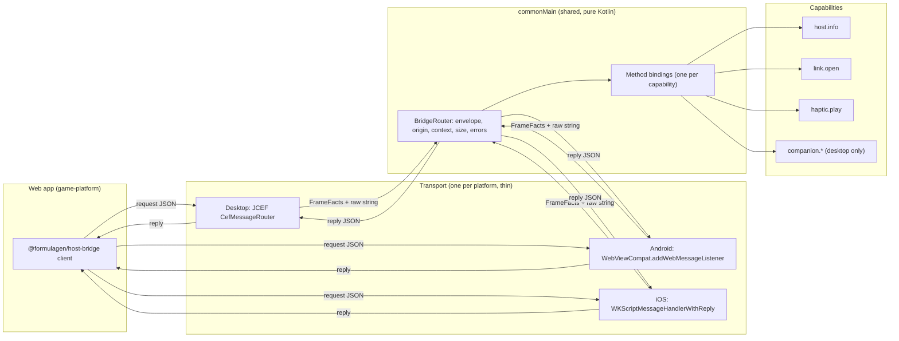

# Host bridge: one reusable bridge for every platform

**Status:** Approved by Tim on 2026-10-14.
**Date:** 2026-10-14
**Feature slug:** `host-bridge`
**ADR:** [ADR-001](../adrs/001-one-host-bridge-protocol.md)

## Summary

Gamero gets one bridge between the web app and the native host. The bridge has
one wire protocol, one router in `commonMain`, and one thin transport for each
platform. Each native feature is a capability. A capability has a typed contract,
and each platform must supply an implementation or an explicit "unsupported"
value. The web app asks the host which capabilities it has, and gets the same
answer shape on desktop, Android and iOS.

## What we have now

The code has two bridges. Only one of them works.

1. **Desktop (works).** `companion/NativeBridge.kt` uses the JCEF message router
   (`gameroQuery`). It has these good properties:
   - It accepts calls only from the main frame of the trusted origin.
   - It limits a request to 4096 characters.
   - It uses a versioned envelope.
   - It binds each document to a `contextId`.

   It carries only the Hovel companion methods. The web side is `game-platform/apps/game-bridge-host/src/hovel/nativeCompanion.ts`.
2. **Mobile legacy bridge (does not work).** `webview/WebBridge.kt` and
   `managers/WebViewManager.kt` use the `compose-webview-multiplatform` JS bridge
   (`deviceEvent`).
   - `onDeviceEvent` registers handlers on each message, but nothing calls
     `dispatcher.dispatch(...)`. No web message reaches the `EventBus`.
   - The callback to the web page is never called, so the web page gets no reply.
   - Koin registers the companion objects of the managers, and nothing resolves
     them. No manager starts, so no manager collects `EventBus` events.
   - `JsCaller` puts `methodName` and `parameters` directly into a JavaScript
     string. A quote in a value can break or inject script.
   - The bridge has no origin check and no main-frame check.
3. **Hovel on mobile.** `HovelAndroidApp` turns the legacy bridge off. iOS has no
   Hovel product mode. Hovel on mobile has no bridge.
4. **Platform code.** About 50 `expect fun platformX` functions carry the
   features. Desktop implements all of them as `throw UnsupportedOperationException`
   (`DesktopLegacyCapabilities.kt`). The web app cannot find out what a host
   supports before it calls.

The desktop bridge is the good pattern. The plan makes that pattern general and
moves it to all platforms.

## Goals

Tim set these goals on 2026-10-14.

1. **Reusable.** To add a native capability, you follow one obvious recipe
   (see "Recipe: add a capability").
2. **Extensible.** You can add a capability or a platform target, and no
   existing caller must change or break.
3. **Consistent.** A capability behaves the same on every platform. It has the
   same API shape, error handling, threading, lifecycle, and the same handling
   of "not supported on this platform" (see "Consistency rules").
4. **Safe by default.** Only the main frame of the trusted origin can call the
   host. The rule is the same on every platform.

### Design priorities

When two choices conflict, use this order:

1. **Composability.** Each capability is a small part that you can add or
   remove alone. A host is a set of these parts.
2. **Maintainability.** Each rule is in one place. A reader finds a
   capability's contract, interface and binding together.
3. **Reusability.** Reuse the patterns that exist (the JCEF context rules,
   kotlinx-serialization, the event-contracts fixtures). Do not add an
   abstraction that only one caller needs.
4. **Extensibility.** Make the next capability and the next platform easy,
   but do not build for capabilities that nobody asked for.

### How the design meets the goals

| Goal | Where the design meets it | Gap and fix |
|---|---|---|
| Reusable | One router, one envelope, one web client. The recipe below. | Fixed in A2b: each capability file declares its methods and a `CapabilityBinder`; the router holds no capability code. |
| Extensible: new capability | Web callers ask `host.capabilities` and do not change. Old methods do not change. | A new `HostCapabilities` parameter makes each platform's factory add one line. This is intended: a forgotten platform is a compile error, not a runtime surprise. |
| Extensible: new platform | A new transport and a new `HostCapabilities` factory. The router and the capabilities do not change. | None. |
| Consistent | The router does all checks, all error mapping and all context rules. Shared fixtures run on every target. The parity test checks the parity table. | Fixed in A2b: every capability method is `suspend`. |
| Safe by default | Frame facts come from the platform API. The router checks them first. | None. |

## Not in scope

- New product features. The first capabilities exist only to prove the pattern.
- The legacy Worldwinner flows (Amplitude, AppsFlyer, Braze, audio). The plan
  freezes them. A separate decision deletes or ports them (see "Open questions").
- Code generation between Kotlin and TypeScript. Shared JSON fixtures check the
  contract first. We add code generation only if the fixtures do not catch drift.

## Design

### Layers



Read the diagram from left to right. The transport only moves strings and reports
frame facts. All rules live in the router. The capabilities hold the platform work.

1. **Contract.** The wire protocol is `host-bridge.v2`. It lives in
   `server-platform/event-contracts` beside `game-result.v1`, as zod schemas and
   JSON fixtures (`valid/` and `invalid/`). Kotlin `commonTest` reads the same
   fixtures.
2. **Router (`commonMain`).** `BridgeRouter` gets a raw string and `FrameFacts`
   (main frame or not, origin, document id). It does these checks in this order:
   1. The call comes from the main frame of the trusted origin.
   2. The request is 64 KiB or smaller.
   3. The envelope is valid and `version` is 2 (or 1 for the desktop companion
      during the move).
   4. The `contextId` matches the current document.
   5. The method exists in the registry.
   6. The arguments decode with the method's serializer.

   Then it calls the capability and encodes the result. It maps each failure to
   one error code. It has no platform imports, so `commonTest` tests all of it.
3. **Transport (`expect`/`actual`, one file each).** A transport does three things:
   1. It receives a string and reports `FrameFacts` that come from the platform,
      never from the page.
   2. It sends a reply or an event as a JSON value, never as a string that it
      puts into script.
   3. It tells the router when the document changes, so the router ends the
      old context and cancels pending calls.
4. **Capabilities.** Each capability is a Kotlin interface with `suspend`
   methods. `HostCapabilities` takes every capability as a constructor
   parameter without a default:

   ```kotlin
   class HostCapabilities(
       val platform: HostPlatform,
       val appVersion: String,
       val links: Capability<LinkOpener>,
       val haptics: Capability<Haptics>,
       val lifecycle: Capability<Lifecycle>,
   )
   ```

   A product capability, such as Hovel's companion, is not a parameter. The
   product passes it to the router as a `CapabilityPack` (ADR-002).

   Each parameter is `Capability.Supported(impl)` or `Capability.Unsupported`.
   A platform that forgets a capability does not compile. The router then
   returns `unsupported` for the methods of an `Unsupported` capability, and
   `host.capabilities` does not list them. Nothing throws at call time.
5. **Web client (`@formulagen/host-bridge`).** It is a small package in
   `game-platform`. It finds the transport (`gameroQuery`, the Android listener
   object, or `window.webkit.messageHandlers`). It gives one API:
   `capabilities()`, `call(method, args)`, `on(event, handler)`. In a plain
   browser it reports no host. `nativeCompanion.ts` moves onto this client.

### Consistency rules

Every capability on every platform obeys these rules. The router enforces the
rules in the first column; a capability or a transport must obey the rest.

| Area | Rule | Who enforces it |
|---|---|---|
| API shape | One method name `area.verb`. Arguments and result are `@Serializable` types in `BridgeMethods.kt`, mirrored by zod in event-contracts. Every reply is `{ok:true, result}` or `{ok:false, error:{code, message}}`. | Router; fixtures in both repos |
| Argument checks | The router decodes and checks the arguments before the capability runs. A capability never gets invalid input. | Router (`BridgeMethod.accepts`) |
| Error handling | A capability throws `BridgeBusyException` for `busy` and `BridgeDeclinedException` for `declined` (K6). Any other exception becomes `failed`, and the host logs it. The page sees only the code and a fixed message, never a stack trace. | Router |
| Threading | The router calls a capability from a background coroutine, never the UI thread. A capability that needs the UI thread switches to it itself (`withContext(Dispatchers.Main)`). A transport may call the router from any thread, and it moves each reply to the thread its platform API needs. | Capability; transport |
| Lifecycle | A context belongs to one document. A navigation, a reload or a closed WebView ends it and cancels the calls that run. A capability must stop when its coroutine is cancelled. A reply for an old context is dropped. Events go only to an open context. | Router; transport reports the document change |
| Not supported | The platform passes `Capability.Unsupported`. Its methods return `unsupported`, and `host.capabilities` does not list them. A capability never throws "not supported" at call time. The parity table in event-contracts says which platform supports what. | Compiler; router; parity test |
| One call at a time | A capability that cannot run two calls at once throws `BridgeBusyException`. It does not queue or wait. | Capability |

### Recipe: add a capability

1. **Contract.** In `server-platform/event-contracts/src/host-bridge`, add the
   methods (zod arguments and result) to `capabilities.ts`, add the row to
   `HOST_BRIDGE_PARITY`, and add the fixtures. Run the contract tests.
2. **Interface.** In gamero `commonMain/.../bridge/`, add one file with the
   interface (`suspend` methods), the argument and result types, and an object
   with the `BridgeMethod` values and a `CapabilityBinder`. `Haptics.kt` is the
   smallest example.
3. **Host parameter.** For a platform capability, add one
   `Capability<YourInterface>` parameter to `HostCapabilities`, and its binder
   to the `bound` list beside it. The compiler then names every platform
   factory that must choose `Supported(impl)` or `Unsupported`. For a product
   capability, add a `pack()` function beside the binder instead, and pass the
   pack from the product's start code on every platform.
4. **Platforms.** Write the implementation in each platform source set that
   supports it. Pass `Capability.Unsupported` in the others.
5. **Fixtures.** Run `tools/sync-host-bridge-fixtures.py` and the router tests.
6. **Web.** Callers use `call("area.verb", args)` from `@formulagen/host-bridge`
   after they check `host.capabilities`.

You do not edit the router, the transports, or other capabilities.

### Recipe: add a platform target

1. Write one transport that reads frame facts from the platform API, passes the
   raw string to `BridgeRouter.handle`, sends replies and events as JSON values,
   and calls `endContext()` when the document changes.
2. Write one `HostCapabilities` factory for the platform.
3. Add the platform to `HostPlatform` and to the parity table.
4. Run the smoke page on the platform.

You do not edit the router or the capabilities.

### Wire protocol v2

Version 1 is the current desktop protocol. It returns a raw result on success,
and a number and a text on failure. Version 2 keeps the same context rules and
adds a fixed result shape, so each platform can return the same thing.

| Message | Direction | Shape |
|---|---|---|
| Open context | web → host | `{version:2, method:"watchContext", args:{}}` → `{version:2, contextId}` |
| Request | web → host | `{version:2, contextId, method, args}` |
| Success | host → web | `{version:2, ok:true, result}` |
| Failure | host → web | `{version:2, ok:false, error:{code, message}}` |
| Event | host → web | `{version:2, event, data}` |

The desktop router accepts version 1 for the companion methods until
`nativeCompanion.ts` uses the new web client (task B3). Then version 1 goes away.
Android and iOS support only version 2.

Error codes: `forbidden`, `invalid`, `expired`, `unknown-method`, `unsupported`,
`busy`, `declined`, `failed`. `declined` means the person said no; K6 (gamero
#30) adds it. An `unsupported` message names the product, the platform and
the capability; until K6 the router sends the fixed message "This host does
not support this method". The message text is for people. Code must read only `code`.

### First capabilities (proof of the pattern)

| Capability | Methods and events | Desktop | Android | iOS |
|---|---|---|---|---|
| `host.info` | `host.capabilities`, `host.info` | yes | yes | yes |
| `link.open` | `link.open` (HTTPS only, system browser) | yes | yes | yes |
| `haptic.play` | `haptic.play` (named effects) | unsupported | yes | yes |
| `lifecycle` | events `lifecycle.pause`, `lifecycle.resume` | yes | yes | yes |
| `companion` | `capabilities`, `prepareConnection`, `activateConnection` | yes | no | no |

`haptic.play` shows the "unsupported" path. `companion` shows a capability that
exists only for one product on one platform.

### Errors and lifecycle

- A navigation or a reload ends the context. The router cancels pending calls
  and the web client opens a new context. Desktop does this now, and the plan
  keeps it.
- One call that fails does not stop other calls. Each call has its own job.
- If a capability throws, the router returns `failed` and logs the exception
  on the host. The page never sees the stack trace.

### Security

- Each transport gets the frame and origin from the platform API:
  - JCEF: `CefFrame.isMain` and `CefFrame.url`.
  - Android: the `allowedOriginRules` of `addWebMessageListener`, `isMainFrame`,
    and `sourceOrigin`.
  - iOS: `WKScriptMessage.frameInfo.isMainFrame` and `securityOrigin`.
- The trusted origin comes from the launch URL policy (`WebUrlPolicy`,
  `IosWebUrl`, `hovelWebUrl`). The page cannot change it.
- No secret goes to the page. Tokens stay in native memory, as now.
- Native → web sends use `postMessage` (Android `JavaScriptReplyProxy`, iOS
  reply handler, JCEF `callback.success`). For pushed events, the transport
  encodes the value with `Json.encodeToString` before it goes into script.

### Test strategy

1. **Contract tests** in `event-contracts`: each fixture parses or fails as its
   folder says.
2. **Router tests** in `commonTest`: the same fixtures go through `BridgeRouter`
   with a fake capability set. These tests run on JVM, Android unit and iOS
   simulator targets.
3. **Parity test**: a test checks that each platform's `HostCapabilities` lists
   the methods that the parity table above says.
4. **Smoke page**: `tools/native-bridge-smoke.html` grows into a page that calls
   every capability and prints one line for each result. We run it on the Mac
   (desktop and iOS simulator) and on an Android debug build through Remote
   Control. The page logs the round-trip time for each call, so the build
   timing work can track bridge speed too.

## Open questions

1. **Legacy managers.** They do not run today. Do we delete them, or port the
   flows that Worldwinner needs onto capabilities? The plan assumes "freeze now,
   decide after phase C".
2. **Contract home.** The plan puts `host-bridge.v2` in
   `server-platform/event-contracts`, beside the other shared contracts. The
   other choice is a new package in `game-platform`.
