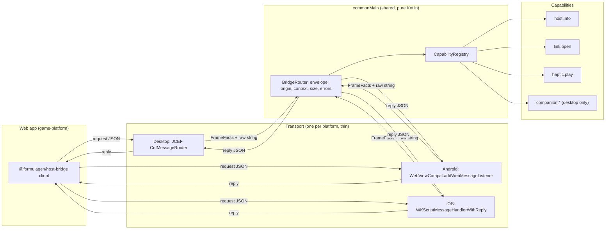

# Host bridge: one reusable bridge for every platform

**Status:** Approved by Tim on 2026-10-14.
**Date:** 2026-10-14
**Feature slug:** `host-bridge`
**ADR:** [ADR-001](../adrs/001-one-host-bridge-protocol.md)

## Summary

Gamero gets one bridge between the web app and the native host. The bridge has
one wire protocol, one router in `commonMain`, and one thin transport for each
platform. Each native feature is a capability. A capability has a typed contract,
and each platform must supply an implementation or an explicit "unsupported"
value. The web app asks the host which capabilities it has, and gets the same
answer shape on desktop, Android and iOS.

## What we have now

The code has two bridges. Only one of them works.

1. **Desktop (works).** `companion/NativeBridge.kt` uses the JCEF message router
   (`gameroQuery`). It has these good properties:
   - It accepts calls only from the main frame of the trusted origin.
   - It limits a request to 4096 characters.
   - It uses a versioned envelope.
   - It binds each document to a `contextId`.

   It carries only the Hovel companion methods. The web side is `game-platform/apps/game-bridge-host/src/hovel/nativeCompanion.ts`.
2. **Mobile legacy bridge (does not work).** `webview/WebBridge.kt` and
   `managers/WebViewManager.kt` use the `compose-webview-multiplatform` JS bridge
   (`deviceEvent`).
   - `onDeviceEvent` registers handlers on each message, but nothing calls
     `dispatcher.dispatch(...)`. No web message reaches the `EventBus`.
   - The callback to the web page is never called, so the web page gets no reply.
   - Koin registers the companion objects of the managers, and nothing resolves
     them. No manager starts, so no manager collects `EventBus` events.
   - `JsCaller` puts `methodName` and `parameters` directly into a JavaScript
     string. A quote in a value can break or inject script.
   - The bridge has no origin check and no main-frame check.
3. **Hovel on mobile.** `HovelAndroidApp` turns the legacy bridge off. iOS has no
   Hovel product mode. Hovel on mobile has no bridge.
4. **Platform code.** About 50 `expect fun platformX` functions carry the
   features. Desktop implements all of them as `throw UnsupportedOperationException`
   (`DesktopLegacyCapabilities.kt`). The web app cannot find out what a host
   supports before it calls.

The desktop bridge is the good pattern. The plan makes that pattern general and
moves it to all platforms.

## Goals

1. **Reusable.** One router, one envelope, one web client for all hosts.
2. **Extensible.** A new capability needs one contract entry, one Kotlin
   interface, and one implementation for each platform. Nothing else changes.
3. **Consistent.** The same request gives the same response shape and the same
   error codes on desktop, Android and iOS. Shared fixtures prove this in tests.
4. **Safe by default.** Only the main frame of the trusted origin can call the
   host. The rule is the same on every platform.

## Not in scope

- New product features. The first capabilities exist only to prove the pattern.
- The legacy Worldwinner flows (Amplitude, AppsFlyer, Braze, audio). The plan
  freezes them. A separate decision deletes or ports them (see "Open questions").
- Code generation between Kotlin and TypeScript. Shared JSON fixtures check the
  contract first. We add code generation only if the fixtures do not catch drift.

## Design

### Layers



Read the diagram from left to right. The transport only moves strings and reports
frame facts. All rules live in the router. The capabilities hold the platform work.

1. **Contract.** The wire protocol is `host-bridge.v2`. It lives in
   `server-platform/event-contracts` beside `game-result.v1`, as zod schemas and
   JSON fixtures (`valid/` and `invalid/`). Kotlin `commonTest` reads the same
   fixtures.
2. **Router (`commonMain`).** `BridgeRouter` gets a raw string and `FrameFacts`
   (main frame or not, origin, document id). It does these checks in this order:
   1. The call comes from the main frame of the trusted origin.
   2. The request is 64 KiB or smaller.
   3. The envelope is valid and `version` is 2 (or 1 for the desktop companion
      during the move).
   4. The `contextId` matches the current document.
   5. The method exists in the registry.
   6. The arguments decode with the method's serializer.

   Then it calls the capability and encodes the result. It maps each failure to
   one error code. It has no platform imports, so `commonTest` tests all of it.
3. **Transport (`expect`/`actual`, one file each).** A transport does three things:
   1. It receives a string and reports `FrameFacts` that come from the platform,
      never from the page.
   2. It sends a reply or an event as a JSON value, never as a string that it
      puts into script.
   3. It tells the router when the document changes, so the router ends the
      old context and cancels pending calls.
4. **Capabilities.** Each capability is a Kotlin interface with typed methods.
   `HostBridge` takes every capability as a constructor parameter:

   ```kotlin
   class HostCapabilities(
       val info: HostInfo,
       val links: LinkOpener,
       val haptics: Haptics,          // or Haptics.Unsupported
       val companion: Companion?,      // null where the product has none
   )
   ```

   A platform that forgets a capability does not compile. A platform that does
   not support one passes the `Unsupported` object. The router then returns
   `unsupported` for its methods, and `host.capabilities` does not list them.
   Nothing throws at call time.
5. **Web client (`@formulagen/host-bridge`).** It is a small package in
   `game-platform`. It finds the transport (`gameroQuery`, the Android listener
   object, or `window.webkit.messageHandlers`). It gives one API:
   `capabilities()`, `call(method, args)`, `on(event, handler)`. In a plain
   browser it reports no host. `nativeCompanion.ts` moves onto this client.

### Wire protocol v2

Version 1 is the current desktop protocol. It returns a raw result on success,
and a number and a text on failure. Version 2 keeps the same context rules and
adds a fixed result shape, so each platform can return the same thing.

| Message | Direction | Shape |
|---|---|---|
| Open context | web → host | `{version:2, method:"watchContext", args:{}}` → `{version:2, contextId}` |
| Request | web → host | `{version:2, contextId, method, args}` |
| Success | host → web | `{version:2, ok:true, result}` |
| Failure | host → web | `{version:2, ok:false, error:{code, message}}` |
| Event | host → web | `{version:2, event, data}` |

The desktop router accepts version 1 for the companion methods until
`nativeCompanion.ts` uses the new web client (task B3). Then version 1 goes away.
Android and iOS support only version 2.

Error codes: `forbidden`, `invalid`, `expired`, `unknown-method`, `unsupported`,
`busy`, `failed`. The message text is for people. Code must read only `code`.

### First capabilities (proof of the pattern)

| Capability | Methods and events | Desktop | Android | iOS |
|---|---|---|---|---|
| `host.info` | `host.capabilities`, `host.info` | yes | yes | yes |
| `link.open` | `link.open` (HTTPS only, system browser) | yes | yes | yes |
| `haptic.play` | `haptic.play` (named effects) | unsupported | yes | yes |
| `lifecycle` | events `lifecycle.pause`, `lifecycle.resume` | yes | yes | yes |
| `companion` | `capabilities`, `prepareConnection`, `activateConnection` | yes | no | no |

`haptic.play` shows the "unsupported" path. `companion` shows a capability that
exists only for one product on one platform.

### Errors and lifecycle

- A navigation or a reload ends the context. The router cancels pending calls
  and the web client opens a new context. Desktop does this now, and the plan
  keeps it.
- One call that fails does not stop other calls. Each call has its own job.
- If a capability throws, the router returns `failed` and logs the exception
  on the host. The page never sees the stack trace.

### Security

- Each transport gets the frame and origin from the platform API:
  - JCEF: `CefFrame.isMain` and `CefFrame.url`.
  - Android: the `allowedOriginRules` of `addWebMessageListener`, `isMainFrame`,
    and `sourceOrigin`.
  - iOS: `WKScriptMessage.frameInfo.isMainFrame` and `securityOrigin`.
- The trusted origin comes from the launch URL policy (`WebUrlPolicy`,
  `IosWebUrl`, `hovelWebUrl`). The page cannot change it.
- No secret goes to the page. Tokens stay in native memory, as now.
- Native → web sends use `postMessage` (Android `JavaScriptReplyProxy`, iOS
  reply handler, JCEF `callback.success`). For pushed events, the transport
  encodes the value with `Json.encodeToString` before it goes into script.

### Test strategy

1. **Contract tests** in `event-contracts`: each fixture parses or fails as its
   folder says.
2. **Router tests** in `commonTest`: the same fixtures go through `BridgeRouter`
   with a fake capability set. These tests run on JVM, Android unit and iOS
   simulator targets.
3. **Parity test**: a test checks that each platform's `HostCapabilities` lists
   the methods that the parity table above says.
4. **Smoke page**: `tools/native-bridge-smoke.html` grows into a page that calls
   every capability and prints one line for each result. We run it on the Mac
   (desktop and iOS simulator) and on an Android debug build through Remote
   Control. The page logs the round-trip time for each call, so the build
   timing work can track bridge speed too.

## Open questions

1. **Legacy managers.** They do not run today. Do we delete them, or port the
   flows that Worldwinner needs onto capabilities? The plan assumes "freeze now,
   decide after phase C".
2. **Contract home.** The plan puts `host-bridge.v2` in
   `server-platform/event-contracts`, beside the other shared contracts. The
   other choice is a new package in `game-platform`.
