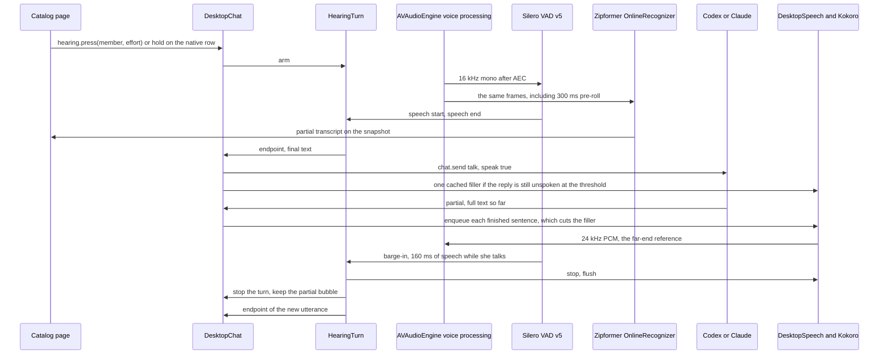

# Two-way voice conversation with Ember

> **For agentic workers:** REQUIRED SUB-SKILL: Use superpowers:subagent-driven-development (recommended) or superpowers:executing-plans to implement this plan task-by-task. Steps use checkbox (`- [ ]`) syntax for tracking.
>
> This document is the plan. It does not contain feature code. Implement it on top of draft PR #56, not on today's `main` PocketTTS speaker.

**Goal:** Tim can talk to Ember in the catalog chat and hear her answer, with turn-taking that feels like a phone call, on device, Mac first.

**Architecture:** The Mac captures the microphone in the same audio graph that plays Kokoro, runs Silero VAD and a streaming Zipformer on the echo-cancelled 16 kHz stream, and on endpoint submits the transcript through the existing `chat.send` talk path. Reply partials are already the full text so far; newly finished sentences are enqueued onto the Kokoro player from PR #56, which synthesizes the next sentence while the current one plays and flushes the device on stop. Barge-in flushes that player and cancels the provider turn. Audio, models, and provider credentials stay in the gamero process.

**Tech Stack:** sherpa-onnx 2.0.0 JVM (already loaded for Kokoro 82M v1.0), Silero VAD v5, streaming Zipformer English int8, AVAudioEngine voice processing on Apple, the host-bridge `chat.*` contract, Kokoro blends Sam / Jamie / Riley / Harper.

## What the draft stack shipped

Phases 1–4 are on `main`. Milestone 5, the browser loop, is a draft in this repo under `web/` because tool-webkit and game-platform were not readable from the agent that wrote it. Milestones 6–7 are not started.

**Browser speech (milestone 5, stacked on #63).** Ember speaks in the browser with the same Kokoro v1.0 graph desktop loads, run by onnxruntime-web 1.30 on WebGPU (WASM CPU fallback) in a module worker. sherpa-onnx's official WASM build was measured first and ran at 1.8 to 2.6 times slower than real time on an M3 Max, so it cannot keep a sentence ahead of playback. The text path is a port, checked against desktop: `SpeechText.kt`, `KokoroLexicon.kt`, and the sentence shaping in `Speech.kt` through `web/hearing/fixtures/speech-text.json` (written by `SpeechWebFixtureTest`), and sherpa-onnx 2.0.0's Kokoro lexicon frontend and `ScaleSilence(0.2)` through `web/hearing/fixtures/kokoro-tokens.json` (token ids sherpa 2.0.0 logged). The download is the model with float16-stored weights (`voice/kokoro/fp16-weights.py`, float32 compute), the four blends cut from `voices-blends.bin`, the tokens and lexicon, and the runtime: 198,251,088 bytes, fetched once by `web/hearing/scripts/fetch-web-voice.mjs`, sha256-checked, and kept in Cache Storage.

- **#59** Click the chat icon to start a session. Another click, Escape, or Stop ends it. Fillers stay in the product and default off (`~/.gamero/voice-fillers`, `HOVEL_VOICE_FILLERS` overrides one launch). One second of quiet after speech sends. Empty text and speech under 240 ms do not. Half duplex until echo cancellation is actually up: the mic is paused while Ember speaks, then about 300 ms.
- **#60** The reply is spoken sentence by sentence. A click or Escape during playback flushes first, cancels the provider turn, keeps the partial text, and leaves the session listening.
- **#61** Full duplex uses one voice-processing graph (`voice/native/ember_audio.m`) for the mic and the speaker. If the library is missing, the graph fails to start, or `~/.gamero/hearing-self-check` says fail, the session stays half duplex and does not leave the mic open. While she is preparing or playing, 250 ms of frames at VAD probability 0.5 or higher flushes playback (`barge-in vad flush_ms=`) and cancels the turn. A short quiet chunk does not wipe that run. Self-echo is discarded (`no_vad_speech`, `too_short`, `self_echo`).
- **#62** The shared contract is server-platform's `ember-hearing.v1` (`event-contracts/src/voice/hearing.v1.ts`): states, actions, endpoint and discard reasons, barge-in, latency caps, and the model checksums. Host-bridge `chat.hearing` and `chatSnapshot.hearing` (`event-contracts/src/host-bridge/chat.ts`) reuse its states and actions. Gamero `voice` `commonMain` (`VoiceConversation.kt`) mirrors it and adds the four Kokoro ids and speeds, sentence gap 160 ms, and fillers default off; `HearingContractTest` checks the mirror against the generated contract fixtures. `ChatSnapshot.hearing` is omitted on host-bridge v2 until the page sends `"hearing": true` on `chat.open`, `chat.openForClient`, `chat.snapshot`, `chat.stop` or `chat.stopSpeaking`, or calls `chat.hearing`; a page does so only when `host.capabilities` lists `chat.hearing`. Until then the native Gamero Adventures row is the control. Ember Tower does not show it. A bare Escape while the catalog page has focus still barges in. No Kotlin/JS target. No game-platform PR yet.

The speaker wait from #56 is kept: playback is not abandoned after two minutes, and a playback thread that fails to start does not block the voice worker. A streamed player that fails to start clears the preparing state.

## Global Constraints

- Build on draft PR [#56](https://github.com/Timwestberg/gamero/pull/56) (`cursor/kokoro-chat-voice-c3ed` at `d4370ed`), which is stacked on #54 / #53. `main` still speaks with PocketTTS and only after the reply is finished.
- Stay on sherpa-onnx 2.0.0. Kokoro and the recognizer share one JNI load. A bump is a separate decision after the spike shows a missing class.
- Kokoro chat stays as #56 left it: backend `kokoro`, 4 threads, sentence gap 160 ms, seed 1, Sam (`adam70-michael30`, speaker id 50) the default, blends Jamie, Riley, and Harper. The speech normalizer and `speechPieces` stay the sentence splitter.
- sherpa-onnx 2.0.0 finishes a Kokoro sentence before the first audio callback. Plan latency around that fact.
- Voice samples and transcripts stay out of Godot. The pet process is not given audio, a transcript, or a credential.
- No token crosses the pet socket. Provider logins stay in the Codex and Claude child processes that chat already starts.
- No CC-BY-NC model, weight file, or clip. Expresso and `test_wavs` stay refused. Kroko ONNX weights are non-commercial and are out of bounds.
- A recording of a person, or a donated clip used to clone a voice, needs that person's explicit consent. This plan does not clone a voice.
- Models and native archives stay gitignored under `spikes/ember-voice/mac/models/`, fetched by a hash-pinned script, same as `scripts/fetch-kokoro.sh`.
- Server contracts go in server-platform `event-contracts`. A reusable SolidJS control goes in tool-webkit. Catalog wiring goes in game-platform. Native audio, the KMP hearing state machine, and the JNI graph go in gamero.
- Rollout: Mac, then the catalog page, then iPhone 14 Pro Max and iPad Pro (the devices `voice/ios-bench/run.sh` already selects), then Android.
- Prefer one on-device pipeline. A platform speech API is a fallback, not a second design.
- English only, matching the Kokoro US English lexicon and the English Zipformer.
- Spoken replies stay capped by `speechText` at 1200 characters. A voice message stays inside `ChatLimits.MESSAGE` (4000).
- Opening a chat does not turn the microphone on.
- Talk mode only. A chat in `awaiting-you` keeps the existing "Answer the approval first." refusal and does not send the transcript.
- GitHub Actions does not run on these repos. Verify locally and say what a machine without a microphone could not run.

---

## 1. What already exists

Read these before changing them. Paths are as of #56 at `d4370ed` unless noted.

| Piece | Where | Behavior to keep |
| --- | --- | --- |
| Kokoro engine | `voice/src/sherpaMain/.../SherpaKokoroEngine.kt` | One `synthesize` call is one sentence. `requestCancel` makes the callback return 0. `usesFrameCeiling()` is false. |
| Speak path | `voice/src/commonMain/.../Speech.kt` `EmberVoice.speakStreaming` | Splits with `speechPieces`, trims, inserts the 160 ms gap, and calls `onSentence` so playback can start while the next sentence is generated. |
| Normalizer | `voice/src/commonMain/.../SpeechText.kt` `normalizeForSpeech` | Numbers, versions, units, URLs, and filenames become words before the split. Unknown tokens are spelled. Nothing is deleted. |
| Player | `composeApp/src/jvmMain/.../chat/DesktopSpeech.kt` | A voice worker synthesizes. A second thread writes `SourceDataLine`. `speak` calls `stopLocked` first, so a second `speak` cuts the first off. `stop` bumps `generation`, cancels the engine, ends the queue, and `flush` / `stop` / `close` on the line. |
| When chat speaks | `DesktopChat.kt` `Reply.completed` | The whole assistant text is passed to `speech.speak` once, and only if `session.speak` is still true. `partial` only updates the bubble. |
| Stop speaking | `ChatCapability.stopSpeaking` | Sets `session.speak = false` and calls `speech.stop()`. The provider turn keeps running. The next `chat.send` sets `speak` from its own argument. |
| Stop the turn | `DesktopChat.stop` | Ends the reply as `cancelled` with notice "Reply stopped.", keeps the partial assistant text, and also stops audio. `end` sets `session.speak = false` until the next send. |
| Partials | `ChatRuntime.TurnEvents.partial` | Each call is the full reply so far, not a delta. Codex can replace the text when a new message item starts. Claude appends. |
| Member | `Handovers.currentMember` | The `to` of the last handover, otherwise the author of the last reply. Null on a fresh chat. The page, not the host, chooses the member on each `chat.send`. `ChatSend.effort` is the page's effort (on `main` after #57). |
| Voice row | `KokoroVoicePicker.kt` | Native Compose row while an Ember chat is open and Kokoro is active. The page does not own it. |
| Contract mirror | `bridge/ChatCapability.kt` | Mirrors `event-contracts/host-bridge/chat.ts`. `VoiceState` is `idle`, `preparing`, `speaking`, `unavailable`, `error`. |
| TTS config | `VoiceConfig` | Local names for ember-voice.v2 (server-platform draft #192). Kokoro's contract slice is `KokoroVoiceContract`: engine, voice id, speed, lexicon sha256. |
| Fetch | `scripts/fetch-kokoro.sh` | Hash-pins the Apache-2.0 Kokoro archive and builds `voices-blends.bin`. |
| Pet | `PetCapability`, `DesktopPetLauncher` | `pet.show` / `hide` / `configure` and an appearance file. No audio channel. |
| iOS bench | `voice/ios-bench/run.sh` | Runs the TTS corpus on every connected iPhone 14 Pro Max and iPad Pro. Simulators are skipped. |

`DesktopSpeech.speak` cannot be called once per sentence. The first line of `speak` is `stopLocked()`, which is what a new typed turn and the stop button need, and what a sentence boundary must not do.

`Reply.completed` is why Ember waits for the whole answer today. Streaming the model into TTS is new work on top of the player #56 already built.

server-platform #192 was not readable from the environment that wrote this plan. Treat `VoiceConfig` and `KokoroVoiceContract` on #56 as the local picture of ember-voice.v2, and read the contract source before adding a field.

## 2. Refinements to the sketch

The sketch is right about the shape: on-device VAD, streaming ASR, endpoint, `chat.send`, sentence TTS, barge-in through the existing flush, Mac first, echo cancellation so Ember does not hear herself.

These are the refinements the rest of the plan follows.

1. **Click-to-converse is the first loop. Full-duplex hands-free is the phone call.** One click starts a session. One second of quiet after speech sends the turn, and listening resumes after Ember finishes. There is no echo canceller yet, so the microphone is ignored while she speaks (half-duplex) and for a short guard after playback goes idle. The phone-call graph, where she can be interrupted while the speaker is on, stays milestone 3. `SourceDataLine` cannot be that graph's far end.
2. **The live recognizer is the streaming Zipformer, not Parakeet and not Kroko.** Kroko's ONNX files are non-commercial. Parakeet TDT 0.6B v3 is CC-BY-4.0 and accurate, and the sherpa build is an offline recognizer of about 630 MB. Waiting to decode the whole utterance misses the budget. It can be a later Mac rescoring experiment. It is not the live path.
3. **Barge-in is `speech.stop()` plus `chat.stop()`, and it is not `stopSpeaking`.** `stopSpeaking` leaves the provider writing. Once sentences enqueue from `partial`, Ember would start again over the person. Cancel the turn. Keep the partial bubble. The new utterance is a new `chat.send` with `speak: true`.
4. **Enqueue, do not call `speak` per sentence.** `speak` flushes. Add `enqueue` that appends one piece to the live generation.
5. **The 800 ms budget counts the silence we wait for, and the model's time to first token.** Local stages have hard caps. The cloud stage is measured and reported beside them. When that wait passes the filler threshold, Ember plays one short lead-in in the voice she is already using. The lead-in is her voice, cached ahead of time. The model's words still follow, and they replace the lead-in.
6. **Hearing is a new contract, `ember-hearing.v1`.** It does not grow ember-voice.v2. v2 is the TTS recipe.
7. **The page shows state and the live transcript. It does not receive PCM.** The Mac host owns the microphone even when the catalog is the JCEF page.
8. **A browser without the host cannot run Codex or Claude.** The web milestone draws the control and, later, runs the same models in WASM for a local loop. It does not add a server speech proxy.

## 3. Architecture and data flow

Threads. The Kokoro worker (`hovel-voice`) and the player thread (`hovel-voice-play`) stay as #56 built them. Hearing gets its own thread (`hovel-hearing`) so a Zipformer decode never waits on a Kokoro sentence, and a Kokoro sentence never waits on the microphone. They meet under `DesktopChat`'s existing gate. The audio callback only enqueues 16 kHz frames. It does not run the recognizer and it does not take the chat gate.

Click-to-converse keeps `SourceDataLine` for playback while echo cancellation is down, because the microphone is closed while Ember speaks. Full duplex replaces both directions with the graph. If voice processing does not start, playback stays on `openSpeaker` and the session stays half duplex. The microphone is not left open on that fallback.

What crosses which boundary:

| Boundary | Crosses | Stays behind it |
| --- | --- | --- |
| Page to host bridge | Hearing commands, a text partial, the existing snapshot | PCM, model paths, credentials |
| Host to Codex / Claude | The transcript as `chat.send` text, the same way a typed line is sent | Audio |
| Host to pet / Godot | Nothing new | Audio, transcript, tokens |
| Disk | The chat history that already stores messages. The voice id in `~/.gamero/kokoro-voice` | Utterance audio, unless the debug flag below is on |

## 4. Component choices

One runtime: sherpa-onnx 2.0.0, Apache-2.0, the jar #56 already loads from `spikes/ember-voice/mac/deps/sherpa/sherpa-onnx-jvm-2.0.0.jar`.

### 4.1 Echo cancellation

Hands-free uses AVAudioEngine with voice processing enabled on the input node, and plays Kokoro through that engine's output node. Apple's voice-processing IO then has the far-end reference. The near-end tap is what VAD and ASR see.

The catalog app is a JVM process (`com.gamero.adventures.prototype`, packaged by `scripts/package-catalog-macos.sh`). The graph is a small JNI library, `voice/native/ember_audio.h`, loaded with `System.load`. Kotlin declares the native methods. JNA is not added.

Push-to-talk does not need the graph. The microphone opens on press and closes on release.

If voice processing fails to enable, hands-free does not silently fall back to an open microphone on `TargetDataLine`. The control goes `unavailable` and push-to-talk still works. WebRTC APM (BSD-3-Clause) is the fallback only if a Mac on the supported OS cannot enable voice processing and a measured loopback test shows why. It is not a second implementation to start.

### 4.2 VAD

Silero VAD v5, MIT, `silero_vad.onnx` about 2.22 MB.

- Source to pin: the `silero_vad_v5.onnx` asset on the sherpa-onnx `asr-models` release, which is the v5 export sherpa's `VoiceActivityDetector` expects. The fetch script records the sha256 it downloaded and refuses a mismatch on the next run.
- License check in that script: the file is MIT, as snakers4/silero-vad states for the model. ten-vad is not used. Its license is a modified Apache-2.0 and this plan does not take that reading on.
- 16 kHz, window of 512 samples (32 ms). That is the only window v5 accepts at 16 kHz.
- Threshold 0.5 to start. The endpoint section owns how many windows make a decision.

### 4.3 Streaming ASR

The live model is the k2-fsa streaming Zipformer trained on LibriSpeech and exported as:

`sherpa-onnx-streaming-zipformer-en-2023-06-26`

Pin these int8 chunk-16 files (chunk 16 is 160 ms of frames; the left context is 128):

| File | Size |
| --- | --- |
| `encoder-epoch-99-avg-1-chunk-16-left-128.int8.onnx` | 71.1 MB |
| `decoder-epoch-99-avg-1-chunk-16-left-128.onnx` | 2.09 MB |
| `joiner-epoch-99-avg-1-chunk-16-left-128.int8.onnx` | 259 KB |
| `tokens.txt` | 5 KB |

The archive that contains them is on the sherpa-onnx `asr-models` release (`sherpa-onnx-streaming-zipformer-en-2023-06-26.tar.bz2`, about 293 MB, which also carries the fp32 files). The fetch script keeps the four files above, records each sha256, and deletes the archive after the check. Decoding is `greedy_search`. Two threads. The recognizer's sample rate is 16 kHz.

License to record in the fetch script before the first use: the icefall recipe and the sherpa-onnx project are Apache-2.0, and LibriSpeech is CC BY 4.0. The script refuses to keep the files if a `LICENSE` inside the archive says non-commercial or CC-BY-NC. If the archive ships no license file, the script's header cites the icefall recipe and the LibriSpeech license, and the files are still Apache-2.0 weights of that recipe. That citation is part of the script, not a comment someone might skip.

Published LibriSpeech numbers for this streaming export are low single digits on test-clean read speech. Conversational WER on a real microphone is unmeasured here. Milestone 0 records it on a consented script before hands-free is called done. This plan does not invent a conversational WER.

### 4.4 Candidates compared

| Candidate | Live path | Streaming in sherpa 2.0.0 | Size | License | Decision |
| --- | --- | --- | --- | --- | --- |
| Zipformer en 2023-06-26 int8, chunk-16 left-128 | Yes | Yes, `OnlineRecognizer` | ~74 MB | Apache-2.0 weights, LibriSpeech CC BY 4.0 | Ship this |
| Zipformer en 20M 2023-02-17 | Fallback | Yes | 122 MB archive, smaller int8 than the 74 MB encoder | Apache-2.0 | Measure only if the 74 MB model misses the phone memory budget |
| Moonshine streaming (moonshine-ai) | Backup | Offline Moonshine is in 2.0.0. A streaming variant needs a jar check | tens to a few hundred MB | MIT on current moonshine-ai cards. Some older usefulsensors files are non-commercial | Eligible only after the Zipformer conversational gate fails, and only with a card that says MIT |
| Parakeet TDT 0.6B v3 int8 (`sherpa-onnx-nemo-parakeet-unified-en-0.6b-int8-non-streaming`, encoder 624 MB) | No | Offline. NeMo's own streaming script uses seconds of right context | ~630 MB | CC-BY-4.0 | A later Mac quality experiment. It does not sit in front of `chat.send` |
| Kroko streaming Zipformer 2025-08-06 | No | Yes | ~71 MB | Non-commercial ONNX | Out of bounds |
| Whisper tiny / base | No | Chunked windows | 75 MB and up | MIT | A window holds the first audio past the budget |
| Apple `SFSpeechRecognizer` on device | Fallback | Yes | nothing to ship | System | Allowed on Mac or iOS only if the Zipformer misses its WER gate and `requiresOnDeviceRecognition` is set. It is not the shared design |
| Browser Web Speech API | No | Cloud on Chrome | nothing to ship | Audio leaves the machine | Out of bounds |
| Any CC-BY-NC ASR or TTS weight | No | | | CC-BY-NC | Out of bounds |

### 4.5 TTS, unchanged

Kokoro 82M v1.0, Apache-2.0, hashes already pinned in `scripts/fetch-kokoro.sh` and `voice/kokoro/blends.json`:

- Model `b40f62b166ac8164b0627ef48a0b358eda0985e272fb03ef5252e7206305da11`
- Tokens `6ebb6bb288f20f3ae8d004d3c2ca27697da27c037d75e81a60e2a6a663f95425`
- Lexicon `7daaab53a181be9885b853a8582bf1838186317e5dadacbcef9c426d6fa0da14`
- Upstream voices `1c5a5b983d3d50d8586d437a51f3faa2da7919ce76a013c081e65671a3447c29`
- Derived blends `35cce6c473585fd74244f31c2623d6f2f835283918dad6fa2e2a79d60639b26f`

Sam is `adam70-michael30` at speed 1.00. The player, the normalizer, the 160 ms gap, and the four names stay. Hearing adds `enqueue`. It does not retune Kokoro.

### 4.6 Endpoint is ours, on top of both models

Silero answers "is this window speech?" Zipformer's `isEndpoint` answers "has this decoded utterance ended?" Commit when the VAD hangover in section 6 has elapsed and the recognizer result is non-empty. Set the recognizer endpoint rules so they do not add a second, longer wait:

- rule 1 minimum trailing silence: 1.2 s (backstop)
- rule 2 minimum trailing silence: 0.32 s
- rule 3 minimum utterance length: 30 s

The VAD hangover is the product knob. The recognizer rule is there so a final result is ready when the hangover ends.

## 5. UX

The microphone stays off until the person asks. Text chat works with the microphone denied, with the model missing, and with Kokoro missing.

### 5.1 Two ways to talk

**Click to converse**, first ship (Tim, 29 Oct 2026). The control is the same chat bubble the Ember desktop pet uses, on the left of the Kokoro voice row. One click starts a session: the microphone listens, and one second of quiet after speech (`HOVEL_HEARING_SILENCE_MS`, default 1000) sends whatever was transcribed as one talk-mode message. The session stays up. Ember replies, then listening starts again on its own. A second click, Escape, or stop ends the session, including a reply that is still speaking. Empty text and a noise-only burst are not sent. The row shows Off, Listening, Thinking, or Speaking beside the icon, and the live partial when there is one.

Until echo cancellation lands, this session is half-duplex. The microphone is ignored while Ember is preparing or speaking, and for about 300 ms after playback goes idle (`HOVEL_HEARING_GUARD_MS`). A reply that is still in flight keeps the microphone closed too, so a gap between a filler and the answer is not a new turn. The icon stays clickable the whole time, so the session cannot stick the way the old hold button did.

**Hands-free**, the phone call, after the echo test passes. That is milestone 3, not this session. It needs the microphone and the speaker on one voice-processing graph, remembered on this Mac in `~/.gamero/hearing-mode` with the same care as the Kokoro voice id (a single word, no audio). While it is on, the graph stays open, VAD endpoints, and barge-in is her hearing the person for 160 ms. Quitting the chat or the window turns the live capture off. The remembered mode arms again the next time that chat opens, after the permission is already granted. A fresh install remembers nothing and stays off.

Mute, while hands-free is on, closes the decision path: frames are dropped, VAD cannot endpoint, barge-in cannot fire. Mute does not stop audio that is already playing. The existing stop-speaking control does that. Mute is "do not hear me."

### 5.2 What the person sees

One control, with a visible name and not color alone.

| State | Name | When |
| --- | --- | --- |
| Off | Mic off | Default. Text chat. |
| Requesting | Allow the microphone | In-app explanation is up, or the system prompt is up |
| Listening | Listening | Armed, VAD idle |
| Hearing | Hearing you | VAD has speech. The composer shows the partial transcript |
| Thinking | Ember is thinking | Transcript committed, no audio yet |
| Speaking | Ember is speaking | `VoiceState.SPEAKING`, already on the snapshot |
| Muted | Mic muted | Hands-free armed, capture dropped |
| Unavailable | Voice input unavailable | Permission denied, model missing, or voice processing failed. The notice says which, and text chat stays |

The partial transcript is the recognizer's current text, shown in the composer and replaced by the normal user bubble when `chat.send` commits it. It is not a second history. A commit of empty text leaves the composer unchanged and does not send.

Permission copy, shown before the first capture, in the catalog and in the native row: "Ember hears you on this Mac to turn what you say into a chat message. The recording is not saved." If macOS has already denied the app, the notice says to turn the microphone on for Gamero Adventures in System Settings. The app does not re-prompt in a loop.

The Kokoro row (Sam, Jamie, Riley, Harper) stays the place the voice is chosen. The mic control joins that row for the first Mac loop, then moves to the catalog composer. Both call the same host method.

### 5.4 Fillers

Tim tried the lead-ins (29 Oct 2026) and finds them weird. The feature stays. It defaults off until the lines are tuned. A Voice-row toggle turns them on, and that choice is saved at `~/.gamero/voice-fillers` the same way `~/.gamero/kokoro-voice` saves the blend (`on` or `off`, one word). `HOVEL_VOICE_FILLERS` still overrides the file for that launch (`1` / `on` / `true` enables, `0` / `off` / `false` disables). Unset, with no file, means off.

A filler is a short lead-in Ember already has as audio: "Hmm,", "Let me think,", or "Okay, so". It is not a second reply, and it is not sent to the provider.

- **When.** The clock starts when a heard turn is sent. If the reply's first speakable piece is not ready within the threshold, she plays one clip. Phase 1 speaks the whole reply from `completed`, so "first speakable piece" there is the start of that `speak`. Phase 2 moves the same signal to the first `enqueue`. The flag and the threshold do not change.
- **Instant.** Each of the four blends has its own clips, synthesized once when that voice's engine is warm and kept as PCM. Playing them writes the buffer. It does not call Kokoro again. A cache that is not warm yet skips the filler and logs `filler skipped cache-cold`. It does not synthesize on the threshold.
- **Varied.** The three lines rotate. The same line is never played on two turns in a row.
- **Once.** At most one filler per hearing turn. A typed send does not arm one.
- **Already arriving.** If `speak` or the first `enqueue` has started, the filler is not started. If the clip is already playing when the reply's audio starts, `speak` / `enqueue` stops it with the same flush as `stop`, then the reply plays.
- **Barge-in.** `speech.stop()` flushes the clip. In the first session, clicking the icon again, Escape, or stop ends the session and cancels an in-flight reply, filler included. Talking over her own audio waits for the echo-cancellation milestone.
- **Flag.** `VoiceConfig.fillersEnabled`, default false, pending tuning. The Voice-row toggle writes `~/.gamero/voice-fillers`. `HOVEL_VOICE_FILLERS` overrides that file at launch. Unset, with no saved choice, leaves them off.
- **Threshold.** `VoiceConfig.fillerThresholdMs`, default 450. `HOVEL_VOICE_FILLER_MS` overrides it. The value is milliseconds from the endpoint to the moment we give up waiting.
- **Log.** Every play logs category `hearing`, `filler line="…" voice=<id> waitedMs=<n>`. A skip logs `filler skipped` and the reason (`disabled`, `reply-ready`, `cache-cold`, `already-played`). That log is how we decide to turn them off.

The 160 ms sentence gap and the lookahead player are unchanged. The filler is before the reply, not between its sentences.

### 5.3 Barge-in

While Ember is speaking, or while a reply is still streaming:

1. Push-to-talk press, or 160 ms of VAD speech in hands-free.
2. `speech.stop()` runs first, so the device flushes before any provider work.
3. The in-flight turn is stopped. The partial assistant text stays in the bubble. The notice is empty, not "Reply stopped.", so a conversation does not look like an error.
4. `session.speak` is left true for the utterance that is about to be sent.
5. The new utterance, including the 300 ms pre-roll from before the VAD trigger, is what the recognizer finalizes.

A cough shorter than the barge-in window does not cut her off. Echo that the canceller removed does not either. The echo test in section 12 is the gate for that claim.

### 5.4 Work and approvals

Hearing sends `MemberMode.TALK` only. While the snapshot is `awaiting-you`, the control does not arm and a release does not send. The existing notice stays. A working reply is not spoken over an approval dialog and is not cancelled by the microphone.

## 6. Turn-taking and endpointing

The state machine lives in common Kotlin so JVM, iOS, and Android run one policy. The web port consumes a fixture exported from its tests.

States: `Idle`, `Armed`, `Speech`, `EndpointPending`, `Committing`, `Muted`, `Closed`.

Inputs: `press`, `release`, `mute`, `unmute`, `speechWindow` (VAD over threshold), `silenceWindow`, `bargeConfirmed`, `stop`, `close`.

Starting policy, locked by tests, changed only when a measured cut-off or a measured echo says so:

| Knob | Value | Why |
| --- | --- | --- |
| VAD threshold | 0.5 | Silero's usual operating point |
| Speech start | 3 windows, 96 ms | Drops a click before the recognizer is treated as "in an utterance" |
| Pre-roll | 300 ms | The first consonant is in the buffer before speech start |
| Short utterance | under 1.2 s of speech | A "yes" or "go on" |
| Trailing silence, short | 240 ms | Keeps a short answer inside the budget |
| Trailing silence, long | 400 ms | A mid-sentence breath in a longer turn |
| Floor | 200 ms | Below this, breath and residual echo become endpoints |
| Barge-in | 5 windows, 160 ms, and only while playback or a reply is active | A cough is not a turn |
| Minimum utterance | 240 ms | A tap does not send |
| Maximum utterance | 30 s | Then force endpoint. The text still has to fit in 4000 characters |
| Recognizer rule 2 | 0.32 s | Matches the long hangover so the two do not stack |

The first Mac session endpoints on 1000 ms of trailing quiet after speech (`HOVEL_HEARING_SILENCE_MS`, clamped 200–5000). That is longer than the 240/400 ms hangover below so a breath does not send a half sentence while there is no echo canceller. The 240/400 ms table is the later hands-free tuning, after milestone 3. A burst under 240 ms is dropped. Silence before any speech does not send.

Commit rule: hangover elapsed, result non-empty, state is not `Muted`, chat is not `awaiting-you`. Then one `chat.send`.

Cut-off gate: read the consented script in section 12, including its written pauses. If a pause inside a sentence is sent as its own turn, raise the long hangover by 80 ms and run the script again. Stop at 640 ms. If it still clips, the script's pause is the bug to listen to, and the number stays 640 ms with that note in the result.

### 6.1 Sentence cursor

`partial` and `completed` feed one cursor. It stores the exact string already given to `enqueue`.

On each partial:

1. Run the reply through `speechText` (code fences, links, backticks, the 1200 character cap).
2. If the raw text has an opening fence with no close, hold from that fence to the end. Do not speak a half-written code block.
3. If the speakable text does not start with the string already enqueued, the provider replaced the reply (Codex can). Flush audio, clear the cursor, and start from the new text.
4. Split the speakable text with the same sentence rules as `speechPieces`.
5. Enqueue every sentence that is already closed by later text. Leave the unfinished tail.
6. First piece of a reply only: if nothing has been enqueued and the unfinished tail has a comma at or before 40 characters, enqueue through that comma once. ember-voice.v2 still splits the benchmark on sentences. This cut is a hearing policy so the first audio does not wait for a long opening sentence.
7. On `completed`, enqueue the remaining tail, including a last sentence with no following text.

`enqueue` appends to the current generation. It does not call `stopLocked`. A new user turn, a barge-in, a voice change, and `close` still call `stop`.

## 7. Latency budget

The clock starts at the last speech sample (the acoustic end), and stops when the first Kokoro sample is audible. Log one line per turn with these marks, category `hearing`, using the existing logger:

`vad_end`, `endpoint`, `asr_final`, `send`, `filler`, `first_token`, `piece_enqueued`, `first_audio`, `speaker_start`.

| Stage | Cap | Notes |
| --- | --- | --- |
| Trailing silence | 240 ms short, 400 ms long | Chosen so she does not cut him off. It is inside the 800 ms |
| ASR finalize after the endpoint | 40 ms | The stream is already decoding |
| Endpoint to `chat.send` | 15 ms | Local, under the chat gate |
| Provider time to first token | measured, no cap we can enforce | Codex and Claude. Often the whole budget |
| Wait for a speakable piece after the first token | 0 when the opening is short, otherwise until the comma cut or the sentence | The 40 character comma cut exists for this line |
| Kokoro of that first piece, 4 threads | 250 ms | #56 measured about 260–290 ms for a full sentence on a Linux VM at 4 threads. The cap is a piece of at most 40 characters on the Mac this is tuned on. sherpa-onnx 2.0.0 does not emit audio earlier than the end of the piece |
| Device start | 30 ms | Included in the 280 ms cap below. The one-second `SourceDataLine` buffer is not on this path once hands-free lands. #56 starts playback on the first non-empty chunk |

Local caps, which a test can fail:

- From the endpoint decision to `chat.send`: at most 80 ms (the 40 ms decode and the 15 ms handoff, with a little room).
- From `piece_enqueued` to `speaker_start` for a piece of at most 40 characters: at most 280 ms, synth and device together.

End to end, acoustic end to first audio, for a short utterance (240 ms hangover) whose first piece is ready when the first token arrives:

- 240 + 40 + 15 + first-token + 280 = 575 ms plus the first token.
- The 800 ms goal holds when that first token arrives within 225 ms of `chat.send`.
- A first token at 400 ms lands near 1.0 s (575 + 400). A first token at 800 ms lands near 1.4 s. Those turns are reported as provider time, not as a hearing regression.
- A long utterance uses the 400 ms hangover, so the same fast token lands 160 ms later. That is the cost of not cutting a sentence in half.

If `speaker_start` has not happened by `fillerThresholdMs` after the endpoint, the `filler` mark is a cached clip starting. That clip is audio, so the first thing Tim hears can be the filler rather than the model's first word. The model's first word is still `speaker_start` of the reply, and the stage log keeps those apart. The overlap #56 already added (next sentence synthesized while the current one plays) keeps the rest of the reply from gaping once the first piece has started. The 160 ms sentence gap stays.

Barge-in flush, from the decision to the device flush, is at most 50 ms. It does not wait for the provider process to exit.

Do not send early in the first hands-free version. A speculative `chat.send` at 240 ms that then hears more speech has already spent a provider turn. Revisit that only after the stage log shows the hangover, and not the provider, is what misses 800 ms.

## 8. How this fits chat and providers

Hearing is a way to fill `ChatSend.text`. It is not a new provider and not a new runtime.

- The member is the one the page passes on press. The native row, until the page button exists, uses `Handovers.currentMember`. If that is null, it does not send, and the notice is "Send one message so Ember knows who should answer."
- Effort is the page's `ModelEffort` when the page armed the microphone. The native-row fallback passes null, which is the runtime default the typed path already uses when effort is absent.
- Mode is `talk`. `speak` is true.
- `requestId` is a new UUID per commit. The existing dedupe applies.
- `DesktopChat.send` already calls `speech.stop()` at the start of a turn. A voice commit uses that path so a leftover sentence cannot play over the new reply.
- History, handover, retry, the reply cap, and the lockdown around Claude and Codex are untouched. The transcript is ordinary user text.
- `partial` gains the sentence cursor and nothing else. Activity lines on a working turn are not spoken. Hearing does not start a working turn.
- `stopSpeaking` stays the button that silences Ember and leaves the text running. Barge-in is a different method, `interruptForHearing`, which flushes audio, stops the turn without the "Reply stopped." notice, and does not clear the speak preference.
- Voice state for playback stays `ChatVoice`. Hearing state is a new optional field so an older page that ignores unknown fields still works.

Provider credentials, `CODEX_HOME`, and Claude's sign-in are unchanged. Hearing code does not read them and does not put them in an environment for the pet.

## 9. Where the code goes

| Repo | Owns | Does not own |
| --- | --- | --- |
| gamero | `HearingTurn`, Silero and Zipformer wrappers, JNI graph, `DesktopHearing`, `enqueue`, the cursor, fetch script, Mac and later iOS and Android capture | The catalog's layout, the contract source of truth |
| server-platform `event-contracts` | `ember-hearing.v1` (model ids, file names, the endpoint numbers, license names) and the host-bridge hearing field and `chat.hearing` method | Audio code, model bytes |
| tool-webkit | A presentational mic control: the states in section 5.2, an accessible name, no audio | Ember copy, `chat.send` |
| game-platform | The composer wiring, the partial transcript, the permission sentence, calling `chat.hearing` with the selected member and effort | A second recognizer, a server ASR route |

`ember-hearing.v1` is new. ember-voice.v2 stays the TTS recipe. Read #192 before naming a field so the two files do not define the same knob twice.

The host-bridge addition, mirrored in `ChatCapability.kt` the way the other chat types are mirrored:

- `HearingState`: `off`, `requesting`, `listening`, `hearing`, `thinking`, `muted`, `unavailable`. Playback stays on `VoiceState`.
- `ChatHearing`: `state`, optional `partial` text (at most `ChatLimits.MESSAGE`), optional `notice`.
- `ChatSnapshot.hearing`, optional, absent when the build has no hearing.
- `chat.hearing` with the scope, an action (`press`, `release`, `handsFree`, `mute`, `unmute`, `off`), the `member`, and optional `effort`. The router rejects any other field. The method never accepts a path, a model file, or a token.

The page polls `chat.snapshot` as it does today. The partial arrives on that poll. PCM does not.

A Kotlin/JS target is not added. The web port's transition table is a JSON fixture the Kotlin tests emit, checked into game-platform when that milestone starts.

## 10. Per-platform path

### Mac, first

JVM on the JBR that already runs the catalog. Milestone 1 and 2 can capture with `TargetDataLine` at 16 kHz while a button is held, and can keep `SourceDataLine` for Kokoro, because capture and playback do not overlap. Milestone 3 moves both to the JNI graph and is the one that needs a real microphone and speaker.

`scripts/package-catalog-macos.sh` builds `Gamero Adventures.app`. The bundle's `Info.plist` needs `NSMicrophoneUsageDescription` with the permission sentence. jpackage writes that plist. Add the key on first package, and re-apply it when the script refreshes jars in an existing app, because a refresh does not rebuild the plist.

TCC is granted to the app the person launched. A Gradle run and the packaged app are different identities. The plan's manual check is on the packaged app.

### Web, second

The catalog page in game-platform is the web surface. Inside the Mac app it is a JCEF page: the button calls `chat.hearing`, and audio stays native. A browser with no host shows the same unavailable state the rest of chat already shows ("Open Hovel on your Mac to connect…").

The on-device browser engine is the milestone after that UI, not a server feature. sherpa-onnx publishes a WASM build, and 2.0.0 has a Kokoro WASM path. The page would use `getUserMedia` with `echoCancellation`, `noiseSuppression`, and `autoGainControl`, the same Zipformer and Silero files, and Kokoro for playback through the Web Audio graph that the browser's canceller hears. Model bytes are downloaded to the origin's cache, hash-checked, and not sent to the Hovel service. Until a browser can complete a real `chat.send`, this engine is a local loop (speak, see the transcript, hear Kokoro read a fixed line), not a second chat backend.

### iPhone and iPad, third

Same `HearingTurn`. Capture and playback use AVAudioEngine voice processing from Swift, next to the existing `voice/ios/ember_voice_bridge.h` sherpa bridge. The recognizer is the sherpa C API in the 2.0.0 xcframework the bench already embeds. `NSMicrophoneUsageDescription` goes on the iOS target. `NSSpeechRecognitionUsageDescription` is not added, because Apple's recognizer is not the path.

Prove it on a connected iPhone 14 Pro Max and an iPad Pro, with `voice/ios-bench/run.sh` as the device selector. Simulators are skipped, as they are for TTS. Add a hearing check beside the TTS corpus once the Mac conversational WER number exists, so the phones are compared to that number and not to a new script.

### Android, fourth

Same `HearingTurn`. `AudioRecord` and `AudioTrack` share one session id so `AcousticEchoCanceler` can attach. Where the canceller is absent, hands-free reports unavailable and push-to-talk remains. The sherpa AAR is the same opt-in `:voice` already has (`voice/libs/sherpa-onnx.aar`, not committed). `RECORD_AUDIO` is requested at the moment of the first press, with the same explanation. The Android minimum stays API 24. The canceller is used where the device offers it, and its absence is the unavailable state, not a crash.

## 11. Privacy

- The utterance PCM lives in the hearing thread's pre-roll and the recognizer's stream. It is dropped when the utterance commits, is discarded, or the chat closes.
- Nothing in this plan writes a wav. `HOVEL_HEARING_DEBUG=1` may write one utterance under the app's log directory for a measurement session, and the default is off. Those files are gitignored.
- The words become a chat message. That message is stored where typed messages are already stored (`companion-chats` under the providers root, mode 0600). Say that in the permission sentence's longer help, and keep the short sentence accurate: the recording is not saved.
- Models are fetched from the pinned URLs, checked, and kept on disk like Kokoro. They are not uploaded.
- The pet, the embedded game, and Godot receive no new channel. `HOVEL_COMPANION_APPEARANCE` stays colors and identity.
- A future "speak in my voice" clip remains the Pocket path's rule: written consent, 1 to 10 seconds, CC0 or a consenting speaker, Expresso and `test_wavs` refused. This plan does not record one.

## 12. Testing and measurement

Local checks, from a checkout that has #56 and the hearing changes:

- `:voice:jvmTest` for `HearingTurn` and the sentence cursor, with a fake clock and a fake recognizer. No model and no microphone.
- `:composeApp:jvmTest` for enqueue-does-not-flush, barge-in, and the existing `DesktopSpeechStreamTest`, `PlaybackGapTest`, `DesktopChatTest`, and `KokoroVoicePickerTest`.
- `voice/jvm-check.sh` still passes for Kokoro.
- A new `voice/hearing-check.sh` exits 0 with "model not installed" when the Zipformer files are absent, and when they are present decodes the archive's own `test_wavs/0.wav` and compares it to a line committed after the first successful run (`voice/hearing/expected-0.txt`). That is a smoke test of the pin, not a WER study.

Conversational WER, on a Mac, once:

- A short script of talk to Ember (names, a number, a file name, a pause inside a sentence, a "yes"). The script text is committed. The wav is not.
- The speaker is someone who has agreed to the recording. Tim reading it for the measurement is that consent, written down in the result note.
- Score WER against the script after the normalizer's expectations (the file name and the number have a spoken form). Record the number in the PR. The gate to leave the Zipformer is a WER the listener would trust for chat, judged by reading the errors, not by a made-up threshold. If the errors are crossed wires on ordinary sentences, milestone 0's backup is a MIT Moonshine model, re-read from its card, or on-device Apple speech on Mac only.

Latency, on a Mac, from the stage log:

- Ten short turns and ten long turns, Kokoro on Sam, the provider that is actually signed in.
- Report p50 and p90 of acoustic-end to `speaker_start`, and the same with provider time removed (`first_token` minus `send`, and `speaker_start` minus `piece_enqueued`).
- The local caps in section 7 fail the milestone if they miss. The 800 ms end-to-end number is reported, and a miss that is all provider time does not send the work back to the recognizer.

Echo, on a Mac, hands-free only:

- Play a fixed Kokoro sentence through the graph with the microphone open and the room quiet.
- Assert VAD does not reach barge-in (5 windows) during that sentence.
- Then speak over the next sentence and assert barge-in does fire.
- This VM has no speaker. The PR states that the echo test was not run here.

Cut-off: the script's written pause, scored as in section 6.

Permission: deny once on a packaged build, see the System Settings notice, text chat still sends. Grant, hold to talk, see the partial, see the user bubble, hear the first sentence before the rest of the reply has finished.

Regression: a typed message with `speak: true` still speaks, stop speaking still silences without cancelling the provider, a voice change still previews "Hi, I'm Sam.", and a missing model still leaves text chat up.

## 13. File map

gamero, new:

- `voice/src/commonMain/kotlin/org/formulagen/wrapper/voice/Hearing.kt` — `HearingTurn` and the knobs.
- `voice/src/commonMain/kotlin/org/formulagen/wrapper/voice/SentenceCursor.kt` — the enqueue cursor.
- `voice/src/commonTest/kotlin/org/formulagen/wrapper/voice/HearingTurnTest.kt`
- `voice/src/commonTest/kotlin/org/formulagen/wrapper/voice/SentenceCursorTest.kt`
- `voice/src/jvmMain/kotlin/org/formulagen/wrapper/voice/SherpaHearing.kt` — Silero plus the online Zipformer, behind a small interface the tests fake.
- `voice/native/ember_audio.h` and the ObjC implementation — the voice-processing graph.
- `composeApp/src/jvmMain/kotlin/org/formulagen/wrapper/chat/DesktopHearing.kt` — thread, capture, commit into `DesktopChat`.
- `scripts/fetch-voice.sh` — also fetches Silero v5 and the Zipformer files, hash-pinned, license-checked. Same script as the Kokoro download, so one command installs hearing and speech.
- `voice/hearing-check.sh`, `voice/hearing/expected-0.txt` after the first real decode.

gamero, edit on top of #56:

- `composeApp/src/jvmMain/kotlin/org/formulagen/wrapper/chat/DesktopSpeech.kt` — `enqueue`, generation left intact.
- `composeApp/src/jvmMain/kotlin/org/formulagen/wrapper/chat/DesktopChat.kt` — cursor on `partial` and `completed`, `interruptForHearing`.
- `composeApp/src/commonMain/kotlin/org/formulagen/wrapper/bridge/ChatCapability.kt` — mirrors server-platform `host-bridge/chat.ts`; `tools/sync-server-fixtures.py` generates the fixtures that check it.
- `composeApp/src/jvmMain/kotlin/org/formulagen/wrapper/chat/KokoroVoicePicker.kt` — the hold control for the first loop.
- `scripts/package-catalog-macos.sh` — microphone usage string.
- `scripts/dev-env.sh` — `HOVEL_HEARING_MODEL` default beside `HOVEL_KOKORO_MODEL`.

server-platform (done): `event-contracts` `ember-hearing.v1`, host-bridge `chat.hearing` and `chatSnapshot.hearing`. No new shared limits: `partial` and `notice` use `CHAT_LIMITS`.

tool-webkit: one presentational control, states from section 5.2, covered by the existing UX test style.

game-platform: composer, partial transcript, bridge call. App copy lives here.

## 14. Milestones

Each milestone is one PR series, based on #56 for gamero. Ship them in order. A later milestone can start its contract draft once the snapshot shape in section 9 is accepted, and it does not merge ahead of the Mac loop.

### Milestone 0 — Load the models and time a file

**Size:** one fetch script, one JNI-free wrapper, one check script. No UI and no chat.

**Files:** `scripts/fetch-voice.sh`, `SherpaHearing.kt`, `voice/hearing-check.sh`.

**Produces:** `HearingEngine` with `fun accept(samples: FloatArray)`, `fun partial(): String`, `fun finalText(): String`, `fun release()`.

- [ ] Confirm `OnlineRecognizer`, `OnlineStream`, and `VoiceActivityDetector` are in the 2.0.0 jar. If a class is missing, stop. Do not bump sherpa inside this milestone.
- [ ] Fetch Silero v5 and the four Zipformer files. Record sha256. Refuse a non-commercial license file.
- [ ] Decode `test_wavs/0.wav`. Commit the transcript as `expected-0.txt`.
- [ ] Log decode time on that file. This is not the conversational WER.

**Done when:** `voice/hearing-check.sh` prints the expected line on a machine with the files, and exits 0 with a clear skip when they are absent.

### Milestone 1 — Mac click-to-converse into the real chat

**Size:** a hearing thread and a chat-icon button on the existing voice row. Medium, because it takes the chat gate and calls `send`.

**Files:** `Hearing.kt`, `DesktopHearing.kt`, `KokoroVoicePicker.kt`, `DesktopChat.kt`, tests.

**Consumes:** `HearingEngine`, `Handovers.currentMember`, `ChatSend`.

**Produces:** one session that sends each endpoint as the existing talk path with `speak = true` and `mode = TALK`.

- [x] A click on the chat icon opens the microphone at 16 kHz. Another click, Escape, or stop closes it. The session does not get stuck if a reply, a cancel, or a voice change lands in the middle.
- [x] One second of quiet after speech sends one talk turn to `currentMember`. Empty text and a burst shorter than 240 ms send nothing. A null member shows the notice in section 8 and sends nothing. The session then keeps listening for the next turn.
- [x] `awaiting-you` does not send.
- [x] While echo cancellation is not up, captured audio is discarded while Ember is preparing or speaking, and listening resumes about 300 ms after playback is idle. Sentence streaming and barge-in are milestone 2.
- [x] Fillers from section 5.4 stay available and default off, pending tuning. The Voice-row toggle persists like the Kokoro voice. `HOVEL_VOICE_FILLERS` overrides it. When they are on: cached per blend, one per hearing turn, skipped when the reply has started, flushed by stop, threshold 450 ms, and a `hearing` log line each time one plays.
- [x] The row shows Off, Listening, Thinking, or Speaking, and the live partial when the recognizer has one.
- [x] Typed chat and Kokoro preview still pass their tests.

**Done when:** clicking the icon on a Mac, saying a sentence, and pausing for a second produces a user bubble and a spoken reply, and a second click ends the session. This VM cannot run that check.

### Milestone 2 — Stream the reply and barge in

**Size:** medium, and the highest regression risk on speech that already works. One cursor and one new player method.

**Files:** `SentenceCursor.kt`, `DesktopSpeech.kt`, `DesktopChat.kt`, tests.

**Consumes:** `speechText`, `speechPieces`, `DesktopSpeech.stop`.

**Produces:** `fun enqueue(piece: String)`, `fun interruptForHearing()`.

- [x] `enqueue` on a live generation does not bump `generation` and does not flush.
- [x] `speak` and `stop` still flush, as they do now. The #56 speaker wait is unbounded, and a playback thread that fails to start does not block the worker.
- [x] The cursor's cases are tests: growing Claude text, a Codex replacement, an unclosed fence, the 40 character comma cut, and the tail on `completed`.
- [x] A press during playback flushes first, cancels the turn, keeps the partial bubble, leaves the notice empty, and can still send the press's utterance with `speak = true`.
- [x] `stopSpeaking` still leaves the provider running and still sets `speak` false.

**Done when:** the first sentence can start playback before `completed`, the existing stream and gap tests pass, and a press cuts the audio.

### Milestone 3 — Hands-free on one audio graph

**Size:** the largest Mac piece. A JNI library and a manual echo test. No contract required for Tim to try it from the native row.

**Files:** `voice/native/ember_audio.h` and its ObjC implementation, `DesktopHearing.kt`, `DesktopSpeech.kt` to play through the graph when hands-free is armed, `package-catalog-macos.sh`, `dev-env.sh`.

**Produces:** `ember_audio_start`, `ember_audio_play`, `ember_audio_flush`, `ember_audio_stop`. Playback samples are the far end. The tap is 16 kHz float for hearing.

- [x] Hands-free uses the graph for both directions. It does not open `TargetDataLine` beside `SourceDataLine` while the graph is up.
- [x] Voice processing failing to start, a missing library, or a failed self-check stays half duplex: the mic closes while Ember speaks, and click-to-converse still works. The mic is not left open without echo cancellation.
- [x] Endpoint is VAD silence, stable text, or a 15 s cap, covered by `TurnCommitter` tests. The first Mac session uses 1000 ms of trailing quiet.
- [ ] The Mac echo self-test, cut-off script, and WER script still need Tim's numbers in the PR. The in-app self-test and `scripts/echo-self-test.sh` exist.
- [x] `Info.plist` carries `NSMicrophoneUsageDescription` on a freshly packaged app and on a jar-refresh package.

**Done when:** a hands-free turn on that Mac survives Ember's own sentence without a false barge-in, a real interruption stops her within the 50 ms flush cap, and the stage log is attached.

### Milestone 4 — Contract and the catalog control

**Size:** medium across four repos, mostly coordination. Start the contract once milestone 1's actions are stable.

**Files:** server-platform `event-contracts` hearing schema and `chat.ts`, the Kotlin mirror and its limits test, a tool-webkit presentational control, the game-platform composer.

**Produces:** the types in section 9. The page passes `member` and `effort` on press.

- [x] An older snapshot without `hearing` still decodes. A v2 `chat.open` omits `hearing` until the page sends `"hearing": true` or calls `chat.hearing`.
- [x] `chat.hearing` rejects a path, a token, or an unknown field.
- [x] The native Gamero Adventures row is the control until the page opts in. A page `press` hides that row's talk icon so only one capture arms. The game-platform composer is not wired yet.
- [x] Permission copy matches section 5.2.

**Done when:** the catalog in the Mac app arms the microphone the host owns, and a browser with no host shows unavailable without asking for a microphone.

### Milestone 5 — Browser on-device loop

**Size:** large (WASM, model download, a TypeScript port of the state machine). It does not block the phones. It does not add a server ASR route.

**Files:** `web/hearing` and `web/catalog` in gamero (the tool-webkit and game-platform split; those repos were not readable here), plus `web/hearing/fixtures/hearing-transitions.json` from `HearingTransitionFixtureTest`.

- [x] The fixture covers every transition the Kotlin test covers. A mismatch fails the web test.
- [x] `getUserMedia` uses the browser's echo cancellation, and Kokoro plays in that same page.
- [x] With a host, the final transcript still goes through `chat.hearing` / `chat.send`. Without a host, the loop stays local and the chat controls stay in their existing unavailable state.
- [x] Model bytes are hash-checked and are not posted to the Hovel service.

**Done when:** a desktop browser shows a partial transcript and plays a Kokoro line with no host, and sends a real turn when the host is present.

### Milestone 6 — iPhone 14 Pro Max and iPad Pro

**Size:** large, and blocked on a Mac that can see the devices. The state machine and the Zipformer files are reused. The audio graph is Swift around the same voice-processing idea, through the existing cinterop style rather than JNI.

- [ ] `NSMicrophoneUsageDescription` only. No speech-recognition usage string.
- [ ] `voice/ios-bench/run.sh` selects the devices. Simulators are skipped.
- [ ] Report WER and the stage log against the Mac script, on both devices.
- [ ] Hands-free stays unavailable if voice processing cannot be enabled. Push-to-talk remains.

**Done when:** both devices complete a push-to-talk turn and a hands-free barge-in, or the PR says which device failed and which cap it missed.

### Milestone 7 — Android

**Size:** large. Same state machine, `AudioRecord` session shared with playback, sherpa AAR.

- [ ] `RECORD_AUDIO` at first press, with the same explanation.
- [ ] Hands-free requires `AcousticEchoCanceler` on that session. Otherwise the mode is unavailable and push-to-talk remains.
- [ ] API 24 stays the minimum. A device without the canceller does not crash.

**Done when:** one physical device completes the push-to-talk turn, and the PR names the device and whether the canceller was present.

## 15. Open questions

Recommended answers, so implementation does not stall. A different answer is a change to this plan, not a silent fork.

1. **Push-to-talk or hands-free first?** Push-to-talk, then the shared graph. The phone call is milestone 3, not milestone 1.
2. **Which recognizer?** The 74 MB Zipformer int8, chunk-16, left context 128, greedy search, sherpa-onnx 2.0.0. Kroko is out. Parakeet is a later experiment. Moonshine only if the consented script's errors are ordinary sentences missed, and only a MIT card.
3. **Is 800 ms a promise?** It is the goal when the provider returns a speakable piece quickly. The enforceable caps are 80 ms from endpoint to send, 280 ms from enqueue to audio for a short piece, and 50 ms to flush on barge-in. Provider time is reported beside those. Fillers default off pending tuning (section 5.4). When the person turns them on, they are a lead-in when the reply misses the threshold, not a substitute for those caps. `HOVEL_VOICE_FILLERS` overrides the saved toggle for that launch.
4. **Cancel the provider on barge-in?** Yes. Flush first, then stop the turn, keep the partial text, send the new utterance as a new message with `speak: true`.
5. **Where is the button?** On the native Kokoro row until the page can pass `member` and `effort`. Then in the catalog composer, backed by a presentational control from tool-webkit. One capture at a time.
6. **Store audio?** No. The chat message is stored as typed messages already are. PCM is dropped. Debug wavs require `HOVEL_HEARING_DEBUG=1`.
7. **Voice during work?** No. Talk only. The mic stays idle on `awaiting-you`.
8. **Bump sherpa?** No. Stay on 2.0.0 unless milestone 0 finds a missing class.
9. **Keep `SourceDataLine` for hands-free?** No. One graph, so the canceller hears the far end. `SourceDataLine` remains the push-to-talk player.
10. **Animate the pet while she speaks?** Not in this plan. No new pet message. A later cue would have to be local, free of audio, and free of secrets.
11. **Whose voice?** The four Kokoro blends. Sam remains the default. Cloning stays behind the existing consent rule and is not part of hearing.
12. **Which language?** English.
13. **Who is the member on a fresh chat?** The page, once it is wired. Before that, `Handovers.currentMember`, and a notice instead of a guess when it is null.
14. **Web speech in the cloud?** No. On device, or the existing "open the Mac app" state.

## 16. Coverage check

| Requirement | Where |
| --- | --- |
| Mac mic and echo cancellation | Sections 4.1, 5.1, milestone 3 |
| VAD | Section 4.2, Silero v5 |
| Streaming ASR, compared and pinned | Sections 4.3 and 4.4 |
| Endpoint, then chat | Sections 6 and 8 |
| Stream the reply into TTS by sentence | Section 6.1, milestone 2 |
| Barge-in via the flush | Sections 5.3 and 8 |
| About 800 ms | Section 7 |
| Fillers on, cached, one per turn, flagged | Section 5.4, milestone 1 |
| Architecture and the diagram | Section 3 |
| UX: push-to-talk, hands-free, indicator, transcript, mute, permission | Section 5 |
| Endpoint tuning | Section 6 |
| Chat and providers | Section 8 |
| Repo placement | Section 9 |
| Platforms, in order | Section 10 |
| Privacy | Section 11 |
| WER, latency, echo | Section 12 |
| Phases and size | Section 14 |
| Open questions with answers | Section 15 |
| No Godot audio, no pet token, no CC-BY-NC, consent | Global constraints, sections 4.4 and 11 |
| No feature code in this change | This file only |
